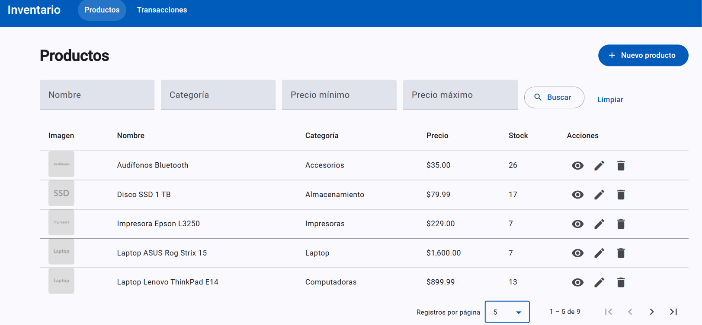
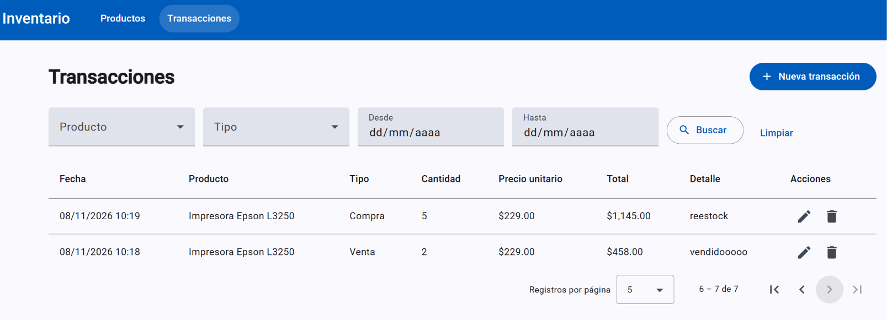
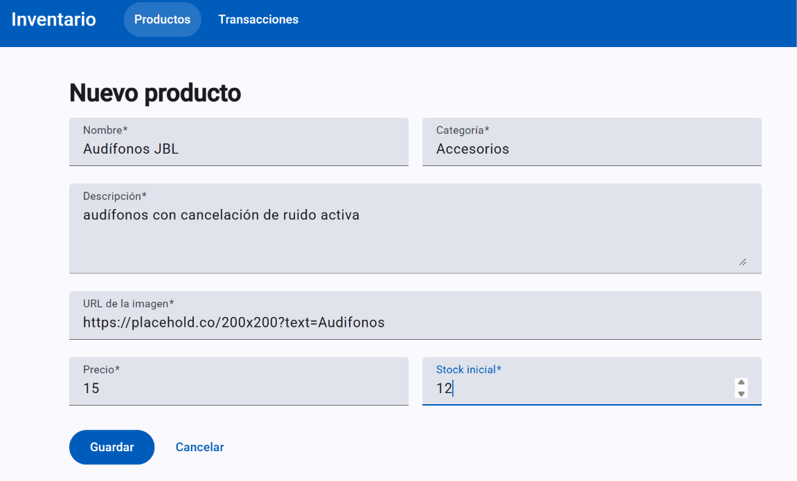
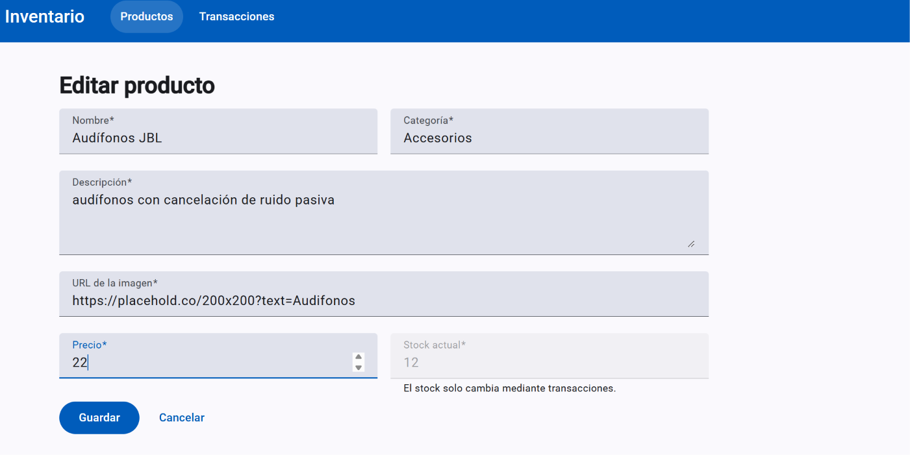
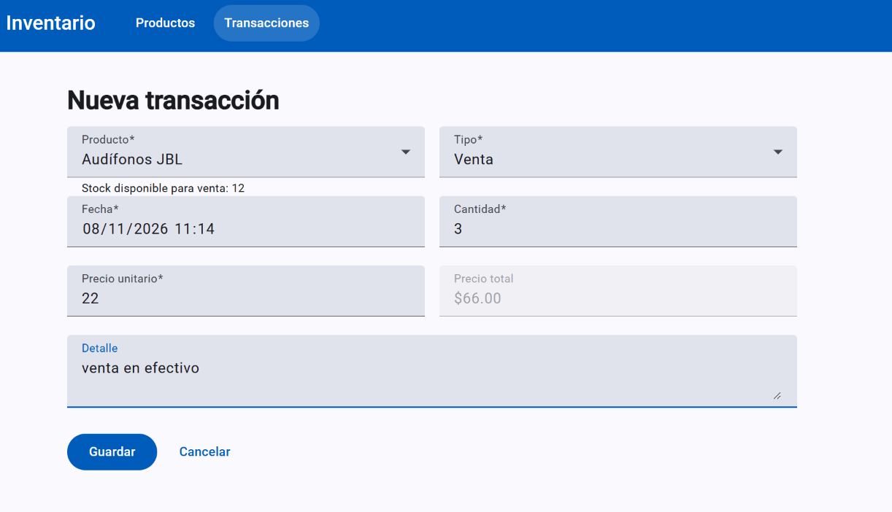
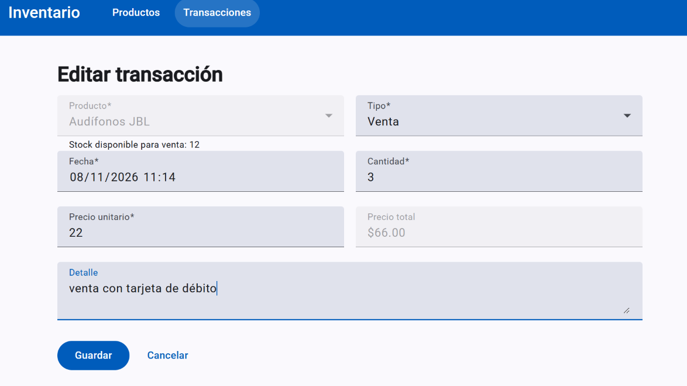
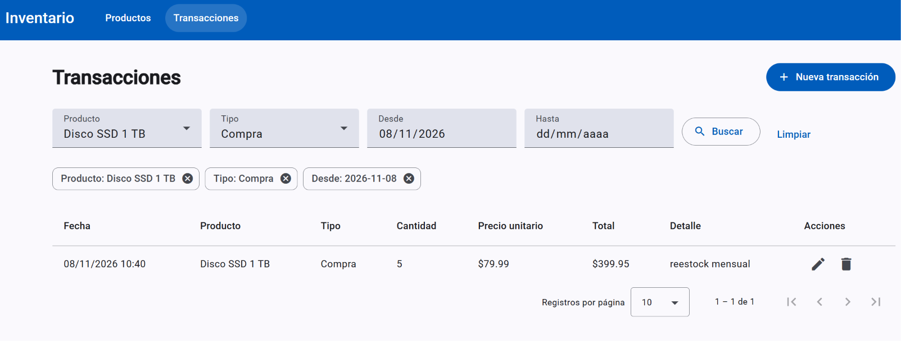
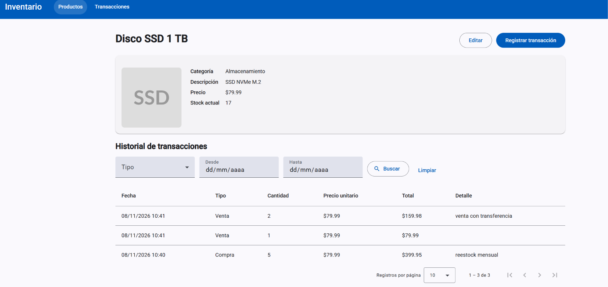
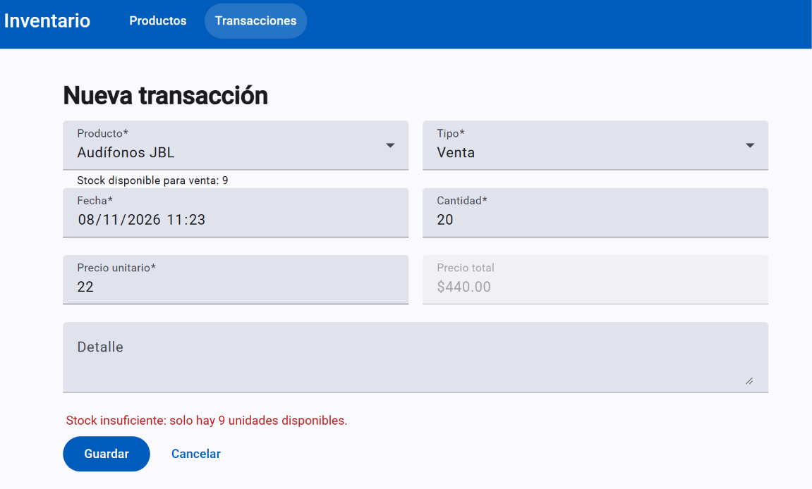

# Inventario – Prueba técnica Fullstack (.NET + Angular)

Aplicación web para gestionar productos y transacciones de inventario, construida con una arquitectura de microservicios en .NET y un frontend en Angular.

```
inventario-fullstack/
├── database.sql                  Script de creación de la base de datos
├── backend/
│   ├── Inventory.slnx
│   ├── ProductService/           Microservicio de gestión de productos   (http://localhost:5001)
│   └── TransactionService/       Microservicio de gestión de transacciones (http://localhost:5002)
├── frontend/                     Aplicación Angular                       (http://localhost:4200)
└── docs/screenshots/             Evidencias
```

### Decisiones técnicas

- Cada microservicio es dueño de su tabla (`Products` y `Transactions`) y no accede a la del otro. Se comunican de forma síncrona por REST: TransactionService llama a `PATCH /api/products/{id}/stock` de ProductService para validar y ajustar el stock.
- El ajuste de stock es atómico (`UPDATE ... WHERE Stock + cambio >= 0`), por lo que dos ventas simultáneas no pueden dejar el stock en negativo.
- Crear, editar y eliminar transacciones actualiza el stock aplicando la diferencia entre el efecto nuevo y el anterior. Si la transacción no se puede guardar, el ajuste de stock se revierte.
- Los errores se devuelven con formato `ProblemDetails` (400, 404, 409 y 503) y el frontend los muestra mediante un interceptor HTTP.
- La paginación y los filtros se resuelven en el servidor.

## Requisitos

| Herramienta | Versión |

| .NET SDK | 10.0 |
| SQL Server | 2019 o superior (Express o Developer), con autenticación de Windows |
| Node.js | 22.22+, 24.15+ o 26+ |
| npm | Incluido con Node.js |
| Visual Studio 2026 o VS Code | Opcional |

## Ejecución del backend

1. **Crear la base de datos.** Ejecutar `database.sql` en SQL Server. Crea la base `InventoryDb`, sus tablas y 8 productos de ejemplo.

   ```powershell
   sqlcmd -S localhost -E -i database.sql
   ```

   También puede abrirse y ejecutarse desde SQL Server Management Studio.

2. **Revisar la cadena de conexión.** Ambos servicios usan por defecto:

   ```
   Server=localhost;Database=InventoryDb;Trusted_Connection=True;TrustServerCertificate=True
   ```

3. **Levantar los microservicios.** ProductService debe estar en ejecución para que TransactionService pueda registrar transacciones.

   **Visual Studio:** abrir `backend/Inventory.slnx`, hacer clic derecho en la solución → *Configurar proyectos de inicio* → *Varios proyectos de inicio* → marcar ambos como *Iniciar* y ejecutar con `Ctrl+F5`.

4. **Verificar.** La documentación de las APIs queda disponible en:
   - ProductService: http://localhost:5001/swagger
   - TransactionService: http://localhost:5002/swagger

## Ejecución del frontend

Con el backend en ejecución, desde la raíz del proyecto:

```powershell
cd frontend
npm install
npm start
```

Abrir http://localhost:4200.


## Evidencias

### Listado dinámico de productos con paginación



### Listado dinámico de transacciones con paginación



### Pantalla para la creación de productos



### Pantalla para la edición de productos



### Pantalla para la creación de transacciones



### Pantalla para la edición de transacciones



### Pantalla de filtros dinámicos



### Pantalla para la consulta de información de un formulario (extra)

Detalle del producto con su historial de transacciones, filtrable por fecha y tipo.



### Validación de stock

No se permite vender más unidades que el stock disponible.


